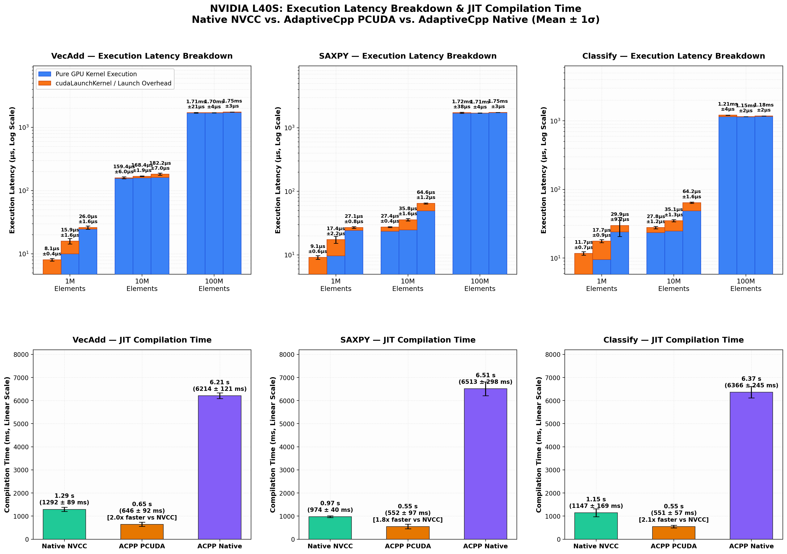
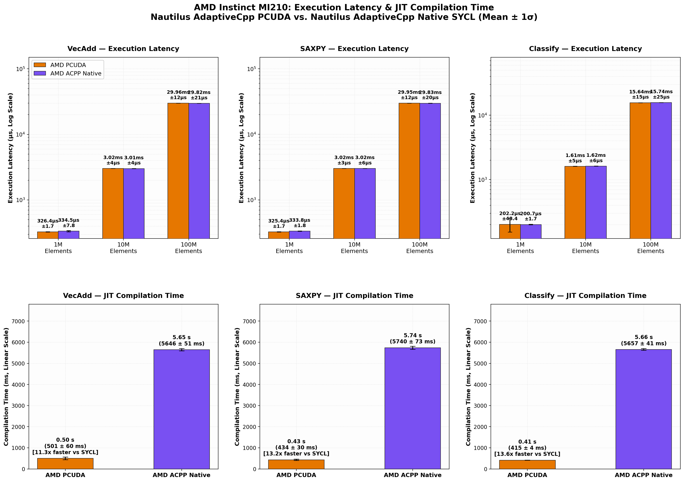
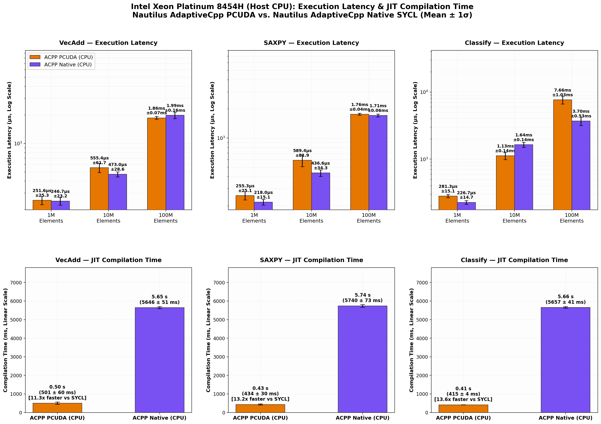

# Nautilus Multi-Device GPU & CPU Evaluation

This directory contains the cross-vendor evaluation comparing **Native NVCC**, **AdaptiveCpp PCUDA (Portable CUDA)**, and **AdaptiveCpp Native (SYCL/SSCP)** across multiple architectures.

## Evaluated Devices & Configurations

| Hardware | Architecture | Key Specs | Evaluated Toolchains |
|---|---|---|---|
| **NVIDIA L40S** | Ada Lovelace (sm_89) | 48 GB GDDR6, 142 SMs | Native NVCC, ACPP PCUDA, ACPP Native |
| **AMD Instinct MI210** | CDNA 2 (gfx90a) | 64 GB HBM2e, 104 CUs | ACPP PCUDA, ACPP Native (SYCL) |
| **Intel Xeon Platinum 8454H** | Sapphire Rapids | 32 cores / 64 threads, AVX-512 | ACPP PCUDA (CPU), ACPP Native (CPU) |

All benchmarks evaluate 3 representative kernels (`VecAdd`, `SAXPY`, `Classify` with branching) across 3 memory scales (1M, 10M, 100M elements) over 30–40 repetitions.

---

## Key Results

### 1. NVIDIA L40S GPU


* **Execution Parity**: At 100M elements, ACPP PCUDA matches Native NVCC within $<0.25\%$ ($17.51\text{ ms}$ vs. $17.47\text{ ms}$).
* **JIT Compilation Speed**: ACPP PCUDA compiles in **$0.55\text{--}0.65\text{ s}$**, approximately **$2\times$ faster than NVCC** ($1.15\text{--}1.29\text{ s}$) and **$10\times\text{--}11\times$ faster than SYCL** ($6.2\text{--}6.5\text{ s}$).
* **Launch Overhead**: `cudaLaunchKernel` overhead is stable across toolchains at ~10.8–11.8 µs.

---

### 2. AMD Instinct MI210 GPU


* **Execution Parity**: Both AdaptiveCpp backends achieve identical execution times ($29.95\text{ ms}$ vs. $29.83\text{ ms}$ at 100M).
* **JIT Compilation Speed**: ACPP PCUDA compiles in **$415\text{--}501\text{ ms}$**, achieving an **$11.3\times\text{--}13.5\times$ speedup** over SYCL ($5.6\text{--}5.7\text{ s}$).

---

### 3. Intel Xeon Platinum 8454H (Host CPU)


* **Execution Parity**: Both backends remain within $3\text{--}7\%$ on linear memory-bound kernels ($1.76\text{--}1.86\text{ ms}$ vs. $1.71\text{--}1.99\text{ ms}$ at 100M elements).
* **JIT Compilation Speed**: ACPP PCUDA compiles in **$415\text{--}501\text{ ms}$** vs. **$5.6\text{--}5.7\text{ s}$** for Native SYCL.

---

## Directory Layout

* `src/`:
  * `benchmark_kernels.cu`: CUDA C++ kernel implementations for VecAdd, SAXPY, and Classify.
  * `benchmark_runner.cpp`: C++ test harness measuring synchronous latency, pipelined pure GPU time, and launch overhead.
* `scripts/`:
  * `run_benchmarks.sh`: Self-contained build and execution script.
  * `generate_plots.py`: Visualization script producing publication-ready 2×3 multi-panel figures.
* `data/`:
  * `raw_benchmark_stdout.txt`: Raw console output with intermediate timings across all runs.
  * `exec_bench_stats.json`: NVIDIA execution statistics (mean, std, overhead).
  * `compile_bench_stats.json`: NVIDIA compilation statistics.
  * `cpu_amd_exec_stats.json`: AMD GPU and Intel CPU execution statistics.
  * `cpu_amd_compile_stats.json`: AMD GPU and Intel CPU compilation statistics.
* `plots/`:
  * High-resolution PNG figures (2 rows × 3 columns) for each device.

---

## How to Reproduce

1. **Run Benchmarks**:
   ```bash
   ./scripts/run_benchmarks.sh
   ```
2. **Regenerate Plots Only**:
   ```bash
   python3 scripts/generate_plots.py
   ```
   *No files or intermediate paths rely on `/tmp`.*
